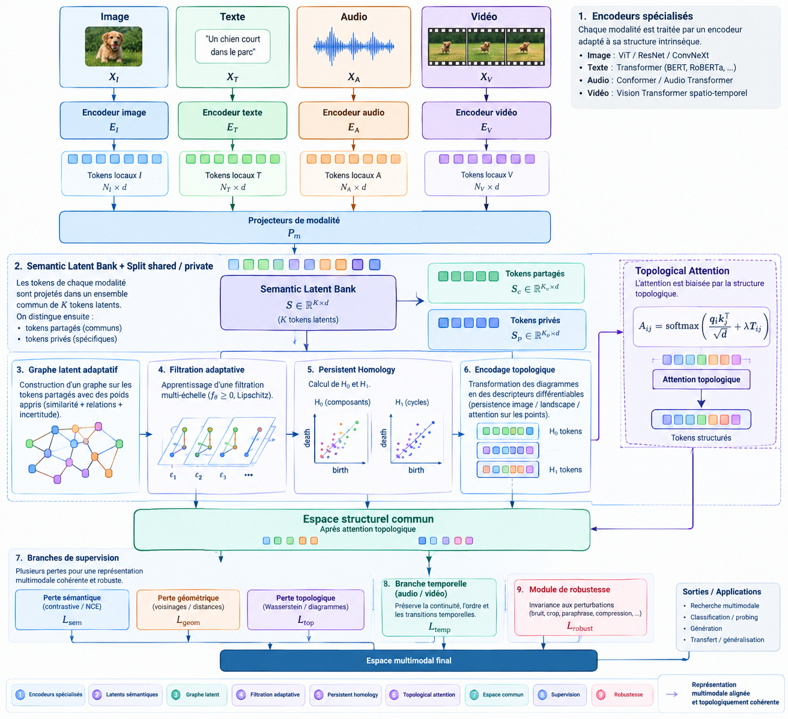
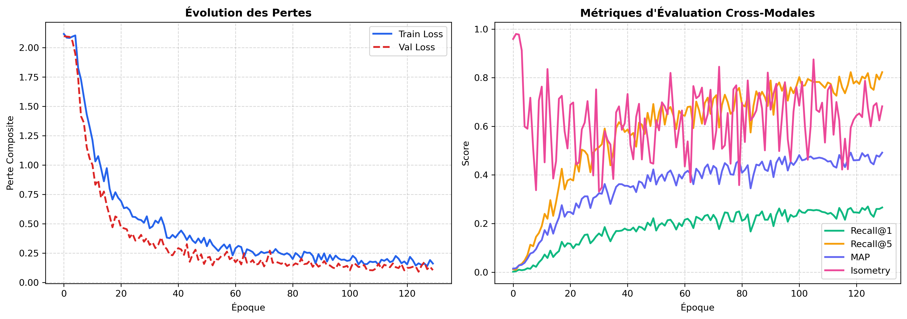
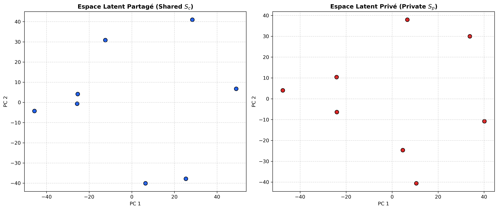
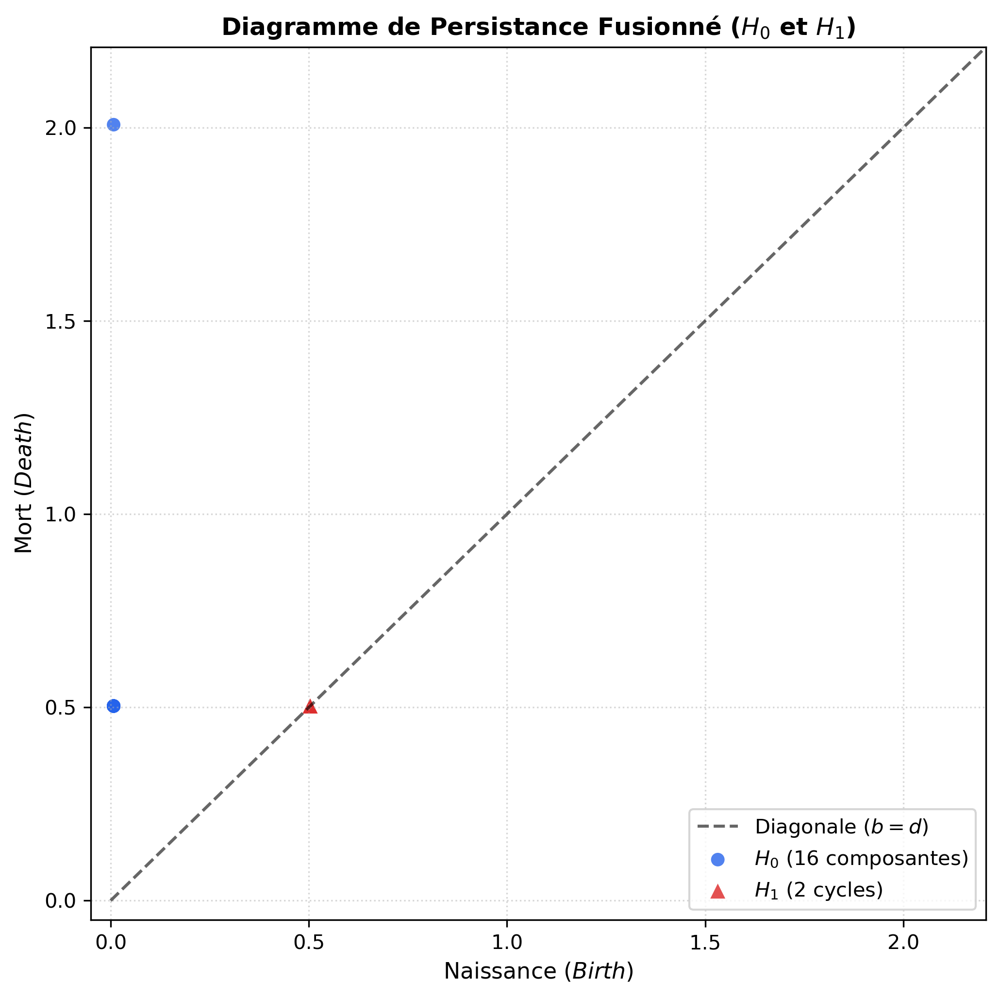
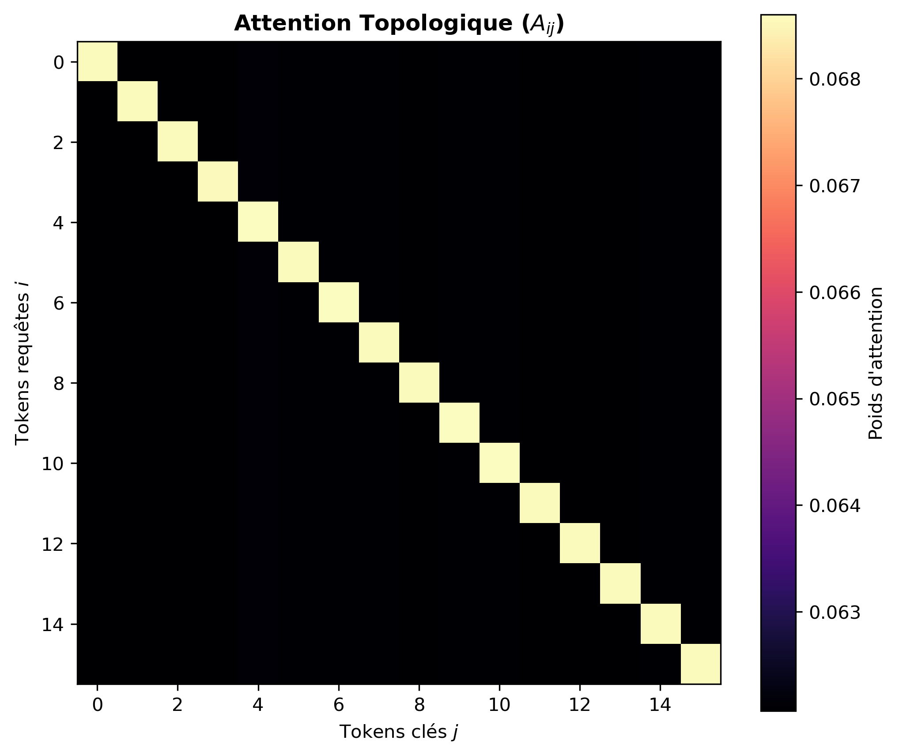

# TopoFusion-TR Hyper

## Apprentissage de représentation multimodale guidé par la géométrie et la topologie



> **Question scientifique.** Comment apprendre un espace latent dans lequel deux modalités différentes représentent la même information sémantique, tout en préservant leur structure intrinsèque et en étant robuste au bruit et aux transformations ?

## 1. Objectif

Cette version constitue une implémentation de recherche de TopoFusion-TR autour de cinq idées :

1. encodeurs spécialisés par modalité ;
2. banque de latents sémantiques avec séparation partagé/privé ;
3. graphe latent adaptatif et filtration apprise ;
4. attention relationnelle biaisée par la structure topologique ;
5. supervision conjointe sémantique, géométrique, topologique et robuste.

Le dataset principal demandé est `HuggingFaceM4/DocumentVQA`, chargé avec `datasets.load_dataset`.

### Stratégie d'Alignement Initial (Initialisation de la Semantic Latent Bank)

Avant de calculer la topologie, nous devons construire un espace sémantique cohérent. La stratégie est la suivante :

* **Encodeurs Spécialisés :** Chaque modalité est encodée indépendamment pour préserver sa structure intrinsèque.
* **Projection Commune :** Les tokens sont projetés dans une dimension $d$ commune.
* **Semantic Latent Bank (Initialisation) :** Nous initialisons $K$ tokens latents apprenables via une initialisation orthogonale (Xavier). Nous ne les initialisons pas avec des embeddings d'une modalité spécifique pour éviter tout biais modal.
* **Cross-Attention Latente :** La banque interroge les modalités via une cross-attention. Les tokens latents agissent comme des "requêtes" universelles.
* **Factorisation Shared/Private :** Après l'attention, les tokens sont séparés en une partie commune ($S_c$) et une partie privée ($S_p^m$) spécifique à chaque modalité.
* **Fusion Adaptative Relationnelle :** Au lieu d'une moyenne naïve, nous utilisons un mécanisme de confiance appris ($\alpha_{m,k}$) pour fusionner les parties communes.

La topologie (Homologie Persistante) n'intervient qu'après ces étapes, pour contraindre et structurer cet espace déjà amorcé.

## 2. Point méthodologique essentiel

Le dataset fourni est **bimodal image + texte**. L'architecture prévoit néanmoins des interfaces audio et vidéo afin que le modèle puisse être étendu sans modifier le cœur du mécanisme. Le pipeline actuel n'invente donc pas de faux audio/vidéo.

La persistent homology exacte est utilisée comme **diagnostic scientifique post-entraînement**. L'optimisation utilise une signature topologique différentiable fondée sur des graphes multi-échelles et leurs opérateurs spectraux. Cette séparation évite de confondre un calcul PH exact non nécessairement différentiable avec une fonction de perte entraînable.

---

## Modules Clés & Justifications Mathématiques

1. **Encodeurs Spécialisés & Projecteurs $P_m$ (Bloc 1)** :
   - Encodeurs dédiés respectant la nature de chaque flux (Vision Transformer, Transformer linguistique, AST spectrogramme, Spatio-Temporal Transformer).
   - Projecteurs $P_m$ multilinéaires avec LayerNorm alignant les représentations sur une dimension commune $d=256$.

2. **Semantic Latent Bank & Factorisation Shared/Private (Bloc 2)** :
   - $K$ tokens latents apprenables orthogonaux $S \in \mathbb{R}^{K \times d}$ servant de requêtes universelles via Cross-Attention.
   - Séparation stricte $K = K_c + K_p$ entre information invariante cross-modale ($S_c$) et traits sensoriels spécifiques ($S_p$), avec pénalité d'orthogonalité pour découplage d'information.
   - Fusion adaptative convexe par réseau de confiance $\alpha_m \in \mathbb{R}^{B \times K_c \times 1}$.

3. **Graphe Latent Adaptatif (Bloc 3)** :
   - Construction d'arêtes apprenables combinant :
     * Similarité cosinus/bilinéaire $\text{Sim}_{ij}$
     * Relations non-linéaires $\text{Rel}_{ij}$
     * Incertitude bayésienne $\sigma_{ij}^2$ modulant les arêtes : $W_{ij} = \sigma\left( \frac{\text{Sim}_{ij} + \text{Rel}_{ij}}{\sigma_{ij}} \right)$.

4. **Filtration Adaptative (Bloc 4)** :
   - Fonction de filtration continue $f_\theta: \mathbb{R}^d \to \mathbb{R}^+$.
   - Contrainte $f_\theta \ge 0$ garantie via Softplus.
   - Propriété $1$-Lipschitz garantie par **normalisation spectrale** (`spectral_norm`) sur les poids, assurant la stabilité topologique au sens du Théorème de Stabilité de Cohen-Steiner, Edelsbrunner et Harer.
   - Seuillage multi-échelle ordonné $(\varepsilon_1 < \varepsilon_2 < \dots < \varepsilon_M)$.

5. **Homologie Persistante $H_0$ et $H_1$ (Bloc 5)** :
   - Calcul des paires de persistance $(\text{birth}, \text{death})$ des composantes 0D ($H_0$) et des 1-cycles / boucles 1D ($H_1$) via un complexe simplicial lower-star Gudhi.

6. **Encodage Topologique Différentiable (Bloc 6)** :
   - Transformation des diagrammes en **Persistence Landscapes** $\lambda_k(t)$ (Bubenik, 2015) :
     $$\Lambda_{(b, d)}(t) = \max(0, \min(t - b, d - t))$$
   - Projection des paysages en tokens discrets $T_{H_0} \in \mathbb{R}^{B \times K_{H0} \times d}$ et $T_{H_1} \in \mathbb{R}^{B \times K_{H1} \times d}$.
   - Pont de gradient différentiable couplant les valeurs nodales de filtration à l'espace latent.

7. **Attention Topologique (Bloc 7 / Espace Structurel)** :
   - Mécanisme d'attention biaisé par la topologie :
     $$A_{ij} = \text{softmax}\left(\frac{q_i k_j^\top}{\sqrt{d}} + \lambda T_{ij}\right)$$
   - Bloc Transformer complet (Pre-LN, résidus, FFN GELU, paramètre $\lambda$ multi-tête apprenable).

8. **Branches de Supervision Multi-Pertes (Bloc 8 & 9)** :
   - $\mathcal{L}_{sem}$ : InfoNCE contrastive symétrique avec température apprenable.
   - $\mathcal{L}_{geom}$ : Préservation isométrique des matrices de distance locales (tokens) et globales (batch).
   - $\mathcal{L}_{top}$ : Distance différentiable sur les Persistence Landscapes ($L_2$ Wasserstein surrogate).
   - $\mathcal{L}_{temp}$ : Continuité (dérivée seconde), ordre temporel contrastif ($d(z_t, z_{t+1}) < d(z_t, z_{t+2})$) et préservation dynamique.
   - $\mathcal{L}_{robust}$ : Invariance aux perturbations (bruit gaussien, masquage de tokens, décrochage modal) et cohérence structurelle d'adjacence.

---


## 3. Arborescence

```text
TopoFusion_TR_Hyper/
├── docs/
│   └── architecture.png             # Architecture fournie par le Ange Landry NOUMBISSI.
├── config.yaml                   # Configuration globale (données, modèle, entraînement)
├── main.py                       # Point d'entrée exécutable (CLI, démo, entraînement)
├── requirements.txt              # Dépendances Python
│
├── data/
│   └── dataset_loader.py         # Chargement optimisé DocumentVQA (sharding, fallback)
│
├── models/
│   ├── __init__.py               # Exports propres
│   ├── encoders.py               # Encodeurs spécialisés ViT, BERT, AST, VideoMAE & Projecteurs P_m
│   ├── latent_bank.py            # SemanticLatentBank, SharedPrivateFactorization, AdaptiveFusion
│   ├── topology.py               # AdaptiveLatentGraph, LearnedFiltration, PersistentHomology, TopologicalEncoder
│   ├── attention.py              # TopologicalAttention, TopologicalTransformerBlock
│   ├── robustness.py             # RobustnessPerturbationModule
│   └── multimodal_framework.py   # Architecture unifiée TopoMultimodalFramework
│
├── losses/
│   └── losses.py                 # L_sem, L_geom, L_top, L_temp, L_robust, CompositeMultimodalLoss
│
├── training/
│   └── trainer.py                # Boucle d'entraînement modulaire en 3 phases, métriques, gradient clipping
│
├── utils/
│   ├── metrics.py                # Recall@K, mAP, Isométrie topologique
│   └── visualization.py          # Visualisations headless (ACP, persistance, attention, courbes)
│
└── tests/
    ├── test_architecture_tda.py  # Suite de tests complète (10 tests unitaires & intégration)
    └── test_trainer_numeric_config.py # Test de rétrocompatibilité Trainer
```

## 4. Installation

```bash
python -m venv .venv
# Windows PowerShell
.\.venv\Scripts\Activate.ps1
# Linux/macOS
source .venv/bin/activate
pip install -r requirements.txt
```

## 5. Vérification immédiate sans télécharger le dataset

```bash
python -m pytest -q
```
ou 
```bash
PYTHONPATH=. pytest -v
```

## 6. Visualiser le dataset réel au début

```bash
python scripts/visualiser_dataset.py --max-samples 32
```

La figure est écrite dans `outputs/dataset/exemples_bruts.png` et les informations du split dans `outputs/dataset/repartition.json`.

## 7. Entraînement

Petit protocole de développement :

```bash
python training/trainer.py --max-samples 512 --epochs 5
```

Protocole plus sérieux :


### Lancer une démonstration rapide (3 phases, génération de graphiques)
```bash
python3 main.py --quick_demo --output_dir outputs
```

### Lancer un entraînement complet
```bash
python3 main.py --config config.yaml --output_dir outputs
```

L'entraînement crée automatiquement :

- `outputs/latent/avant_apres.png` ;
- `outputs/training/courbes_pertes.png` ;
- `outputs/training/courbes_validation.png` ;
- `outputs/validation/metriques_validation.json` ;
- `outputs/test/metriques_test.json` ;
- `outputs/test/metriques_test.png` ;
- `outputs/topology/diagrammes_persistance.png` si GUDHI est installé ;
- `outputs/rapport_final/resultats.json`.

## 8. Protocole expérimental

```text
                  DATASET HF
                      │
             ┌────────┼────────┐
             ↓        ↓        ↓
           TRAIN      VAL      TEST
             │         │        │
             │         └── sélection du checkpoint
             ↓
      TopoFusion-TR / baseline
             │
             ↓
     représentation commune
             │
       ┌─────┼──────┐
       ↓     ↓      ↓
    sémantique géométrie topologie
       │     │      │
       └─────┼──────┘
             ↓
          robustesse
             │
             ↓
     évaluation finale TEST
             │
       ┌─────┼──────────────┐
       ↓     ↓              ↓
 retrieval geometry     topology exact
```

Le test n'est pas utilisé à chaque époque : il reste réservé à l'évaluation finale afin de limiter le risque de fuite expérimentale.

## 9. Baselines

- **B0** : encodeurs + projection + moyenne + classifieur/retrieval sans contrainte d'alignement ;
- **B1** : B0 + alignement contrastif global ;
- **B2** : B1 + alignement géométrique des matrices de distances ;
- **B3** : B2 + topologie différentiable multi-échelle ;
- **TopoFusion-TR** : B3 + banque shared/private + filtration adaptative + attention topologique + robustesse.

Les baselines B0-B3 disposent d'un constructeur et d'un script d'entraînement séparé (`scripts/entrainer_baseline.py`). B0 est volontairement dépourvue d'alignement, B1 utilise l'objectif contrastif, B2 ajoute la géométrie et B3 ajoute le proxy topologique multi-échelle. L'objectif scientifique est de mesurer séparément l'apport de chaque mécanisme, et non de déclarer une nouveauté sur la seule base du diagramme architectural.

## 10. Métriques

### Sémantique / retrieval

- Recall@1, Recall@5, Recall@10 image→texte ;
- Recall@1, Recall@5, Recall@10 texte→image ;
- mAP image→texte ;
- mAP texte→image.

### Géométrie / structure

- erreur relative des matrices de distances ;
- préservation des voisinages @5 et @10 ;
- trustworthiness.

### Robustesse

- similarité cosinus clean/corrompu ;
- Recall@1 clean/corrompu ;
- dégradation relative du Recall@1.

### Topologie

- nombre de classes finies H0/H1 ;
- persistance totale H0/H1 ;
- persistance maximale H0/H1 ;
- distance de Wasserstein H0/H1 ;
- distance de bottleneck H0/H1 ;
- diagrammes de persistance.

## 11. Limites honnêtes

La démonstration initiale utilise uniquement les deux modalités effectivement présentes dans le dataset fourni. Pour une publication, les conclusions sur l'extension audio/vidéo devront être établies sur un véritable dataset multimodal contenant ces modalités. De même, une amélioration des métriques ne constitue pas à elle seule une preuve de nouveauté : il faudra comparer plusieurs baselines, plusieurs seeds, des corruptions contrôlées et idéalement plusieurs datasets.


## Visualisations Générées

Les graphiques sont sauvegardés automatiquement dans le dossier `outputs/` :


- `outputs/dataset_samples.png` : Échantillons multimodaux du dataset DocumentVQA



- `outputs/training_curves.png` : Courbes des pertes composites et métriques (Recall@1, Recall@5, mAP)

  
  
- `outputs/latent_space.png` : Analyse en composantes principales (ACP) des espaces Partagé ($S_c$) vs Privé ($S_p$)



- `outputs/persistence_diagram.png` : Diagramme de persistance $H_0$ et $H_1$ (Birth vs Death)



- `outputs/topological_attention.png` : Carte thermique de la matrice d'attention topologique $A_{ij}$

B0-B3 sont volontairement séparées du protocole principal afin de ne pas mélanger sélection de checkpoint et comparaison des contributions.


=================================================================================================================


# TopoFusion-TR Hyper

Prototype de recherche sur l'apprentissage de représentations image-texte guidé par la géométrie et l'homologie persistante.

Ce dépôt répond à une question précise : **ajouter des contraintes topologiques à un alignement contrastif image-texte améliore-t-il la recherche inter-modale, sa robustesse ou la préservation de la structure ?** La réponse mesurée, y compris lorsqu'elle est négative, figure dans la section [Résultats](#résultats).

| Point | État réel |
|---|---|
| Modalités exécutées | Image et texte réels (légendes CSV + images COCO train2014) |
| Audio et vidéo | Interfaces expérimentales, jamais exécutées, refusées par la configuration |
| Meta | DINOv2 exécuté localement. Muse Spark n'est ni appelé ni utilisé dans les résultats |
| Garantie démontrée | Stabilité des diagrammes par rapport aux points d'entrée de la filtration, et rien au-delà |
| Matériel utilisé | CPU à 4 cœurs, 15 Go de RAM, sans GPU |

## Motivation

Un alignement contrastif rapproche les paires image-texte, sans contrainte explicite sur la forme globale de l'espace latent. Deux modèles aussi performants en recherche peuvent déformer très différemment les voisinages, les amas et les cycles de leurs données d'entrée.

TopoFusion-TR Hyper étudie si cette structure peut être préservée à partir de trois leviers :

1. une perte géométrique qui préserve les relations de distance ;
2. une homologie persistante différentiable qui contraint les composantes (H0) et les cycles (H1) ;
3. une voie structurelle qui injecte des descripteurs topologiques dans l'embedding et l'attention.

Le protocole isole chaque levier par une variante et une ablation. Une référence CLIP pré-entraînée sert de point de comparaison externe.

## Architecture

```text
Image (COCO)                                      Légende
   │                                                 │
DINOv2-small gelé (CLS + grille 4×4)          BERT gelé (24 tokens)
   │                 caractéristiques en cache       │
   └───────────── Projecteurs P_m ───────────────────┘
                         │
          ┌──────────────┴───────────────┐
    Voie sémantique                 Banque latente (24 tokens)
    moyenne + tête                       │
          │                Tokens partagés (12) │ Tokens privés (12)
          │                       │                      │
          │              Graphe latent adaptatif     Reconstruction
          │                       │
          │              Filtration 1-lipschitzienne (SVD exacte)
          │                       │
          │              Rips pondéré, H0 et H1 (GUDHI), valeurs relues
          │              dans le tenseur PyTorch pour le gradient
          │                       │
          │              Paysages, Betti douces → tokens H0 et H1
          │                       │
          │              Attention biaisée par l'ultramétrique
          │                       │
          └── z = normalize(sémantique + gamma · h(structure))
```

L'image [docs/archi.png](docs/archi.png) est le **schéma de conception d'origine**. Elle montre l'audio, la vidéo, une perte temporelle et des applications de génération qui ne sont pas implémentés. Le schéma ci-dessus décrit ce qui est réellement exécuté.

| Module | Fichier | Rôle |
|---|---|---|
| Encodeurs et projecteurs | [models/encoders.py](models/encoders.py) | Encodeurs gelés, référence CLIP, extensions audio/vidéo expérimentales |
| Banque latente et fusion | [models/latent_bank.py](models/latent_bank.py) | Cross-attention, factorisation partagé/privé, fusion adaptative avec modalités absentes |
| Moteur topologique | [models/topology.py](models/topology.py) | Filtration, persistance exacte et différentiable, paysages, Betti douces, ultramétrique |
| Attention topologique | [models/attention.py](models/attention.py) | Attention multi-têtes biaisée par la structure |
| Modèle complet | [models/multimodal_framework.py](models/multimodal_framework.py) | Assemblage et variantes B0 à B4 |
| Perturbations | [models/robustness.py](models/robustness.py) | Vue perturbée utilisée pendant l'entraînement |
| Objectif composite | [losses/losses.py](losses/losses.py) | InfoNCE, géométrie, topologie, robustesse, orthogonalité, reconstruction, variance |
| Entraînement | [training/trainer.py](training/trainer.py) | Trois phases, points de contrôle, arrêt précoce, détection de NaN |

### Variantes expérimentales

| Variante | Contenu |
|---|---|
| B0 | Projection naïve : alignement cosinus sans négatifs |
| B1 | InfoNCE |
| B2 | B1 + isométrie géométrique approchée |
| B3 | B2 + représentation topologique |
| B4 | Modèle complet : banque, graphe, tokens topologiques, attention, perturbations, tous les termes |
| `B4_sans_L_top` | B4 sans perte topologique |
| `B4_sans_tokens_topo` | B4 sans tokens H0 et H1 |
| `B4_sans_attention_topo` | B4 sans biais de l'attention |
| `B4_sans_robustesse` | B4 sans perturbation ni perte de robustesse |
| `B4_sans_topologie` | Banque et fusion seules, sans aucune topologie |
| CLIP | `laion/CLIP-ViT-B-32-laion2B-s34B-b79K`, évalué tel quel, sans entraînement ici |

## Fondements mathématiques

Le détail, les démonstrations et les références figurent dans [docs/FONDEMENTS_MATHEMATIQUES.md](docs/FONDEMENTS_MATHEMATIQUES.md).

Trois niveaux de calcul sont distingués :

| Niveau | Usage | Propriété |
|---|---|---|
| Persistance exacte (GUDHI, Ripser) | Diagnostic et évaluation | Sans gradient |
| Persistance différentiable | Optimisation | Appariement exact, valeurs relues dans le tenseur. Gradient défini presque partout |
| Descripteurs auxiliaires | Tokens topologiques | Paysages exacts sur la grille, courbes de Betti douces approximatives |

La filtration est un Rips pondéré sur une métrique apprise :

```text
F(i)  = w_i
F(ij) = max(w_i, w_j, (D_ij + w_i + w_j) / 2)
```

`D` et `w` sont calculés par des réseaux dont chaque couche a une norme spectrale au plus égale à 1, mesurée par SVD exacte.

**Proposition démontrée.** Pour deux nuages `U` et `U'` indexés par les mêmes sommets, avec `delta = max_i ||u_i − u'_i||` :

```text
d_B(Dgm_k(F_U), Dgm_k(F_U')) ≤ (L_phi + L_w) · delta ≤ 2 · delta,   pour k = 0, 1
```

| Propriété | Statut |
|---|---|
| Stabilité des diagrammes par rapport aux points d'entrée de la filtration | Démontrée, sous les hypothèses énoncées |
| Stabilité des représentations latentes par rapport aux pixels ou aux mots | Non garantie |
| Robustesse de la recherche | Seulement mesurée, jamais certifiée |
| Isométrie | Non garantie : la corrélation de Mantel ne préserve qu'une relation affine des distances |

## Structure du dépôt

```text
config.yaml                     Configuration de référence, validée au chargement
main.py                         Point d'entrée : preparer, experiences, plan, resultats, figures, commentaires
data/                           Chargement réel, cache de caractéristiques, corruptions
models/                         Encodeurs, banque, topologie, attention, modèle complet
losses/                         Objectif composite
training/                       Boucle d'entraînement
evaluation/                     Recherche, topologie, diagnostics, robustesse
integrations/                   Adaptateur Meta Model API
scripts/                        Pipelines de préparation, expériences, agrégation, figures, archive
tests/                          Tests pytest
utils/                          Configuration, graines, métriques, visualisation
docs/                           Fondements, audit, suivi des corrections, résultats, limitations, intégration Meta
outputs/                        Résultats, figures et journaux des expériences
```

## Installation

Version utilisée : Python 3.12.7 sous Linux, en CPU.

```bash
python -m venv .venv
source .venv/bin/activate        # Windows PowerShell : .venv\Scripts\Activate.ps1

# Sans GPU : installe PyTorch en version CPU avant les autres paquets.
pip install torch==2.5.1 torchvision==0.20.1 --index-url https://download.pytorch.org/whl/cpu
pip install -r requirements.txt
```

Sous Linux, un simple `pip install -r requirements.txt` installe PyTorch avec les bibliothèques CUDA : l'environnement occupe alors 5,9 Go. Pour un GPU, suivez les instructions de [pytorch.org](https://pytorch.org). L'exécution sous Windows et sur GPU n'a pas été testée.

## Préparation des données

```bash
python main.py preparer --threads 8
```

Cette commande :

1. charge `load_dataset("AhmedSSabir/Textual-Image-Caption-Dataset", split="train")`, puis se replie explicitement sur `All_Caption_ID.csv` si le schéma du dépôt fait échouer l'appel strict ;
2. valide les légendes et compte les rejets ;
3. télécharge les images depuis COCO train2014 et remplace les fichiers indisponibles à partir d'une réserve ;
4. découpe les données par hachage de l'image, de façon déterministe, avec toutes les légendes d'une image dans le même sous-ensemble ;
5. extrait et met en cache les caractéristiques DINOv2 et BERT, y compris pour les images et textes corrompus du test.

Le manifeste produit contient les empreintes de chaque sous-ensemble. Aucune donnée synthétique n'est utilisée : si les vraies données sont absentes, le programme s'arrête avec une erreur explicite.

Mesures sur le jeu réel : 413 388 lignes lues, 413 253 légendes valides, 82 783 images. Le protocole retient 8 000 images d'entraînement (24 000 légendes), 1 000 de validation (4 992 légendes) et 1 000 de test (4 992 légendes). Le cache occupe 2,5 Go.

## Entraînement

```bash
# Plan complet, comme pour les résultats de ce dépôt.
python main.py plan --processus 4 --threads 1

# Une variante et une graine.
python main.py experiences --variantes B4 --graines 42 --threads 4 --reprise

# Référence CLIP seule.
python main.py experiences --variantes aucune --clip
```

L'objectif composite s'active en trois phases : base contrastive et géométrique (20 %), puis perte topologique (30 %), puis objectif complet avec perturbations (50 %). Les paramètres figurent dans [config.yaml](config.yaml). Les réglages `lr`, `geom` et `top` ont été choisis sur la validation avec [scripts/tune_validation.py](scripts/tune_validation.py), puis gelés.

Relancer le plan reprend le travail : une expérience terminée avec la même empreinte de configuration est réutilisée, et une expérience interrompue repart de son dernier point de contrôle.

## Évaluation

Chaque expérience évalue son meilleur point de contrôle une seule fois sur le jeu de test. Pour les variantes avec perte topologique ou de robustesse, ce point est choisi parmi les époques de la phase 3, sur la validation uniquement.

| Famille | Mesures |
|---|---|
| Recherche | R@1, R@5, R@10, mAP, rang médian, dans les deux directions, avec plusieurs légendes pertinentes |
| Comparaison | Bootstrap apparié par requête, avec intervalle à 95 % |
| Robustesse | Bruit gaussien, flou, masquage d'image, suppression de mots, corruption de caractères, modalités manquantes. Valeur absolue et dégradation relative |
| Structure | Corrélation de Mantel, stress de Kruskal, préservation des voisinages, bottleneck et Wasserstein-1 exacts |
| Stabilité | Vérification de la borne sur de vraies corruptions, violations comptées |
| Diagnostics | Rang effectif, effondrement, alignement, séparation partagé/privé, normes de gradient |
| Coûts | Durée d'entraînement, inférence, persistance, mémoire, paramètres |

```bash
python main.py resultats
```

Cette commande écrit `outputs/resultats/resume.json` et [docs/RESULTATS.md](docs/RESULTATS.md), générés à partir des seuls fichiers d'expériences.

## Visualisation

```bash
python main.py figures
```

Les figures sont écrites dans `outputs/figures/` : échantillons bruts, courbes de perte, courbes R@1 et R@5, espace latent avant et après entraînement, comparaison à CLIP, diagrammes H0 et H1, paysages, graphe latent, attention, robustesse, ablation, courbes de Betti et stabilité.

## Résultats

Toutes les valeurs ci-dessous viennent de [docs/RESULTATS.md](docs/RESULTATS.md), généré à partir des fichiers d'expériences. Test : 1 000 images et 4 992 légendes, jamais utilisées pour l'entraînement ni pour la sélection. Le hasard donne R@1 = 0,10 % et R@5 = 0,50 %.

### Réponse à la question scientifique

**Dans ce cadre expérimental, les composants topologiques n'améliorent ni la recherche, ni la robustesse, ni la structure mesurée.** Le moteur topologique fonctionne comme prévu : persistance exacte, gradient vérifié, borne de stabilité jamais violée. Mais son ablation ne dégrade aucun résultat, et en améliore même certains.

Le modèle complet B4 dépasse bien les références contrastives, d'environ 2 points. Ce gain vient de la banque latente, de la fusion et des termes auxiliaires, et non de la topologie.

### Recherche inter-modale

Moyenne ± écart-type sur les graines, en %.

| Modèle | Graines | R@1 | R@5 | mAP |
|---|---|---|---|---|
| B0 : projection naïve | 3 | 0,66 ± 0,22 | 2,13 ± 0,40 | 1,16 ± 0,11 |
| B1 : InfoNCE | 3 | 30,60 ± 0,72 | 64,75 ± 0,74 | 36,57 ± 0,19 |
| B2 : + géométrie | 3 | 30,80 ± 0,84 | 64,77 ± 0,54 | 36,85 ± 0,14 |
| B3 : + représentation topologique | 3 | 30,99 ± 0,90 | 64,88 ± 0,39 | 36,87 ± 0,15 |
| **B4 : complet** | 3 | **33,20 ± 1,19** | 66,68 ± 0,57 | 38,80 ± 0,36 |
| B4 sans aucune topologie | 3 | 32,78 ± 0,46 | **67,23 ± 0,29** | **39,28 ± 0,34** |
| B4 sans tokens H0/H1 | 2 | 32,67 ± 0,11 | 67,92 ± 0,10 | 39,44 ± 0,22 |
| B4 sans perte topologique | 2 | 33,39 ± 0,46 | 66,89 ± 0,23 | 38,88 ± 0,22 |
| B4 sans attention topologique | 2 | 32,69 ± 0,57 | 67,12 ± 0,22 | 38,63 ± 0,18 |
| B4 sans robustesse | 2 | 33,28 ± 0,61 | 66,65 ± 0,80 | 38,85 ± 0,22 |
| CLIP pré-entraîné (référence externe) | - | 64,75 | 88,06 | 65,03 |

Différences appariées sur les requêtes de test, en points, avec intervalle à 95 % par bootstrap. Ces intervalles ne reflètent pas la variabilité entre graines.

| Comparaison | ΔR@1 | ΔR@5 | ΔmAP | Lecture |
|---|---|---|---|---|
| B2 − B1 | +0,60 [+0,15 ; +1,06] | +0,61 [+0,17 ; +1,03] | +0,62 [+0,37 ; +0,88] | Faible gain, du même ordre que l'écart entre graines |
| B3 − B2 | +0,11 [−0,31 ; +0,53] | +0,01 [−0,43 ; +0,42] | +0,03 [−0,20 ; +0,27] | Aucun effet de la représentation topologique |
| B4 − B1 | +2,60 [+2,05 ; +3,15] | +2,41 [+1,86 ; +2,93] | +2,41 [+2,08 ; +2,73] | Gain net du modèle complet |
| B4 − B4 sans topologie | −0,12 [−0,62 ; +0,33] | −0,64 [−1,11 ; −0,19] | −0,58 [−0,86 ; −0,33] | La topologie n'apporte rien et coûte un peu en R@5 et mAP |
| B4 − B4 sans tokens H0/H1 | +0,01 [−0,60 ; +0,58] | −1,17 [−1,73 ; −0,65] | −0,73 [−1,11 ; −0,37] | Les tokens topologiques dégradent légèrement R@5 |
| B4 − CLIP | −28,35 [−29,64 ; −27,06] | −20,17 [−21,30 ; −19,07] | −24,16 [−25,17 ; −23,20] | Très loin derrière la référence pré-entraînée |

Les ablations sans perte topologique, sans attention topologique et sans robustesse ne diffèrent pas de B4 de façon significative. Sur B4 déjà entraîné, remplacer les tokens H0/H1 par des zéros ne change presque rien : R@1 passe de 33,20 à 32,77 %. La porte qui dose la voie structurelle reste à 0,253, très près de sa valeur initiale de 0,25.

### Robustesse

B4 obtient un R@5 absolu supérieur à B1 dans les 10 scénarios de corruption, de 1,5 à 4,3 points, avec une dégradation relative un peu plus faible. Cet avantage ne vient pas de la topologie : B4 sans topologie fait mieux que B4 dans 9 scénarios sur 10. Il ne vient pas non plus de l'entraînement de robustesse : B4 sans robustesse fait mieux que B4 dans 7 scénarios sur 10, avec des écarts inférieurs à 1 point pour la plupart. CLIP reste nettement plus robuste, en valeur absolue comme en dégradation relative.

En l'absence d'une modalité, B4 retrouve son propre embedding fusionné complet avec un R@1 de 99,2 % à partir de l'image seule, et de 97,1 % à partir du texte seul.

### Structure et topologie

- **La perte géométrique fait ce qu'elle promet.** De B1 à B2, la corrélation de Mantel entrée-latent passe de 0,680 à 0,827 pour l'image et de 0,367 à 0,677 pour le texte. La préservation des 10 plus proches voisins de l'image passe de 0,594 à 0,653.
- **La topologie n'améliore pas la structure mesurée.** Les corrélations de Mantel, les distances de Wasserstein et de bottleneck entre diagrammes image et texte de B3 et B4 restent du même ordre que celles de B2 et de B4 sans topologie, ou légèrement moins bonnes.
- **Partagé et privé sont bien séparés dans B4.** Les tokens partagés sont alignés entre modalités (0,508) et les tokens privés ne le sont pas (0,000). Leur recouvrement est faible : cosinus absolu de 0,026 pour l'image et 0,022 pour le texte.
- **La borne de stabilité n'est jamais violée**, sur 10 scénarios et 3 graines. Le rapport maximal observé entre distance de bottleneck et déplacement est compris entre 0,078 et 0,118, pour une borne de 2. Elle est donc vraie, mais lâche d'un facteur 17 à 26.

### Coûts

| Modèle | Paramètres | Entraînement (15 époques) | Inférence par paire |
|---|---|---|---|
| B1 | 0,69 M | 3 min | 0,77 ms |
| B3 | 1,16 M | 15 min | 2,99 ms |
| B4 | 3,02 M | 47 min | 4,87 ms |
| B4 sans topologie | 2,68 M | 30 min | 3,38 ms |

L'inférence ne compte que les têtes entraînables, sans les encodeurs gelés. Le calcul d'une persistance prend 0,45 ms par nuage de 12 tokens dans B4. Le pic mémoire est de 2,9 Go. Le plan complet de 26 expériences demande environ 3 h 30 à 4 h sur un processeur à 4 cœurs.

### Pourquoi la topologie n'apporte rien ici

Un constat est mesuré. Sur 256 images de test et leurs légendes, un nuage de 12 tokens de B4 compte en moyenne 0,3 à 1,8 cycle H1 selon la graine. La persistance médiane de ces cycles vaut 0,002 à 0,004, soit environ 1 % de l'échelle de filtration (0,26 à 0,41). Les tokens H1 décrivent donc surtout des structures quasi nulles.

Deux autres pistes restent des hypothèses, non testées ici :

- la perte géométrique aligne déjà les distances, ce qui rendrait la perte de signature topologique en grande partie redondante ;
- avec des encodeurs gelés, seules des têtes légères s'adaptent, ce qui limite ce qu'une contrainte de structure peut changer.

Expériences qui permettraient de trancher : une variante B1 + perte topologique sans perte géométrique, des encodeurs affinés, et des nuages plus grands pour la persistance.

### Figures

Les figures sont dans `outputs/figures/` : `01_echantillons_bruts`, `02_courbes_perte`, `03_courbes_recall`, `04_latent_avant_apres`, `05_clip_vs_topofusion`, `06_diagrammes_persistance`, `07_paysages_persistance`, `08_graphe_latent`, `09_attention_topologique`, `10_robustesse`, `11_ablation`, `12_stabilite_borne` et `13_betti_douce_vs_exacte`. Deux générations successives produisent des fichiers identiques octet par octet.

## Limitations

La liste complète figure dans [docs/LIMITATIONS.md](docs/LIMITATIONS.md). Les principales :

- un seul jeu de données et un sous-ensemble de 10 000 images, sur 82 783 ;
- des encodeurs gelés, avec DINOv2-small imposé par le coût sur CPU ;
- 15 époques au maximum, 3 graines pour le cœur du protocole, 2 pour quatre ablations ;
- des réglages choisis sur la validation, sur une graine et une petite grille ;
- aucune garantie au-delà des points d'entrée de la filtration, aucune robustesse certifiée ;
- CLIP est pré-entraîné sur un corpus massif, donc la comparaison n'est pas faite à entraînement égal ;
- audio et vidéo jamais exécutés, Muse Spark jamais appelé, Windows et GPU non testés.

## Reproductibilité

- Graines : 42, 43 et 44. Elles couvrent l'initialisation, l'ordre des lots, le dropout et les perturbations.
- Découpage déterministe, avec empreintes écrites dans le manifeste.
- Chaque résultat contient l'empreinte de la configuration. Cette empreinte ne couvre pas le code : après une modification du code, supprimez `outputs/runs/` avant de relancer.
- `requirements.txt` fixe les versions utilisées.
- Une reprise après interruption donne exactement les mêmes poids qu'une exécution continue, d'après un test CPU sur un petit jeu.

Les tests se lancent avec :

```bash
pytest -q                    # Suite complète, avec les tests longs et les ressources réelles
pytest -q -m "not slow"      # Suite rapide
python main.py commentaires  # Contrôle des commentaires ligne par ligne
```

## Intégration Meta

Le détail et les sources figurent dans [docs/INTEGRATION_META.md](docs/INTEGRATION_META.md).

| Élément | Statut |
|---|---|
| DINOv2 (poids ouverts Meta) | **Réellement utilisé** comme encodeur d'image gelé, exécuté localement |
| Muse Spark (Meta Model API) | **Non utilisé dans les résultats.** Un adaptateur existe, testé seulement contre un serveur simulé |
| Embeddings internes de Muse Spark | Non documentés par Meta, donc non utilisés. `MetaModelApiClient.internal_embeddings()` lève une erreur explicite |

Formulation exacte : *« TopoFusion-TR Hyper utilise DINOv2 de Meta comme encodeur d'image et propose un adaptateur vers la Meta Model API, non exécuté à ce jour. »*

La clé n'est jamais écrite sur le disque. L'envoi d'images à l'API exige `MODEL_API_KEY` et une confirmation explicite :

```bash
export MODEL_API_KEY="votre-cle"
python scripts/meta_describe_images.py --nombre 8 --confirmer-envoi
```

## Documentation

| Document | Contenu |
|---|---|
| [docs/RAPPORT_AUDIT.md](docs/RAPPORT_AUDIT.md) | Audit du code d'origine, défauts classés par priorité |
| [docs/SUIVI_CORRECTIONS.md](docs/SUIVI_CORRECTIONS.md) | Correction et test associés à chaque défaut |
| [docs/FONDEMENTS_MATHEMATIQUES.md](docs/FONDEMENTS_MATHEMATIQUES.md) | Définitions, démonstration, portée des garanties |
| [docs/RESULTATS.md](docs/RESULTATS.md) | Résultats complets, générés depuis les expériences |
| [docs/LIMITATIONS.md](docs/LIMITATIONS.md) | Ce que le prototype ne démontre pas |
| [docs/INTEGRATION_META.md](docs/INTEGRATION_META.md) | Faits vérifiés sur l'API Meta, statut de l'adaptateur |

